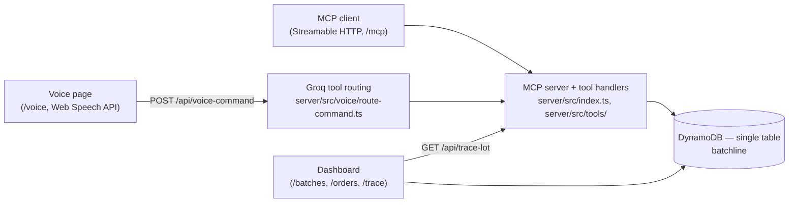

# Batchline

**Voice-first recall tracing for small food producers.**

When an ingredient lot is recalled, it has to be traced from the lot through every batch it went into and out to the customer orders those batches shipped to. Small producers usually do that across notebooks and spreadsheets, by hand, while customers wait. Batchline keeps that chain in one place: batches, lots, orders and their links in a single DynamoDB table, with an MCP server that answers "who received product made from this lot?" in one call — and a voice layer on top so the whole flow can be driven hands-free.

## Demo flow

1. **Record a batch by voice.** "Record batch BATCH-2026-03-14-001 with 10 kg of lot LOT-FLR-2026-0117." The `record_batch` tool writes the batch and its lot links in one transaction.
2. **Trace a recalled lot.** `trace_ingredient_lot` follows the lot to every batch that used it, then to the customer orders those batches shipped to, and splits the orders by collection status.
3. **Preview and approve a response.** `preview_response` drafts hold / notify / flag actions for the affected orders without changing anything and returns a `previewId`; `commit_approved_response` executes an approved preview exactly once.
4. **Correct a mistaken lot.** `correct_batch_record` replaces a wrong ingredient lot on an existing batch. The original link stays in the table, marked superseded, so the record is auditable.

What makes it trustworthy:

- **The trace never guesses.** Orders are bucketed as collected, uncollected or incomplete; an order with no collection status at all counts as incomplete, not as some assumed value. The voice prompt forbids inventing arguments — if a lot or batch ID wasn't said, it asks instead of filling one in.
- **Corrections are append-only.** Nothing is deleted: a corrected lot link is superseded, not removed, and a `CORRECTION` item records what happened.
- **The LLM only translates speech into a tool call.** Its arguments are re-validated against the tool's real Zod schema on the server before anything runs; invalid arguments execute nothing and are read back as a clarifying question. Order IDs are never model-generated.

## Architecture



The MCP server is one Node process (`server/src/index.ts`): the MCP Streamable HTTP transport and two REST endpoints (`/api/voice-command`, `/api/trace-lot`) share port 3001. `/api/voice-command` sends the transcript to Groq for tool selection, validates the returned arguments, and executes the same handler the MCP server registers. The dashboard (`dashboard/`) reads the same DynamoDB table directly for the order and batch boards, and calls `/api/trace-lot` for the trace graph.

## MCP tools

| Tool | Purpose |
| --- | --- |
| `record_batch` | Record a new production batch and link its ingredient lots, atomically |
| `correct_batch_record` | Replace a wrong ingredient lot on an existing batch; the original link is kept and marked superseded |
| `trace_ingredient_lot` | Trace a lot across batches to the customer orders they shipped to, split by collection status |
| `preview_response` | Draft hold / notify / flag actions for the affected orders without changing anything; returns a `previewId` |
| `commit_approved_response` | Execute an approved preview, exactly once per idempotency key |
| `register_order` | Register a customer order linked to a batch, with its collection status stated explicitly |
| `update_collection_status` | Mark an order collected or uncollected, recording who changed it |

**Voice-layer-only commands** — `draft_response_from_trace` and `approve_pending_response` are *not* MCP tools. They are defined only in `server/src/voice/tool-definitions.ts`, never registered on the MCP server, and never exported over MCP. They exist so a spoken conversation can span requests: the first expands a per-collection-status policy against the trace stored earlier in the session and drafts it through the real `preview_response` tool; the second commits that session's pending preview through the real `commit_approved_response` tool with a server-built idempotency key.

## Engineering notes

- **Atomic writes with conditional guards** — `server/src/tools/record-batch.ts` puts the batch metadata and every lot link in one `TransactWriteCommand`, each item guarded by `ConditionExpression: attribute_not_exists(PK)` so a duplicate batch or lot link aborts the whole transaction. The same pattern is used by `register-order.ts`, `correct-batch.ts` and `update-collection-status.ts`.
- **Idempotency keys with request hashing** — `server/src/tools/commit-response.ts` stores a SHA-256 hash of `{ previewId, orderActions }` on the `IDEMPOTENCY#` record, written in the same transaction as the order updates. Replaying the same key with the same hash returns the stored result without re-executing; reusing a key for a different request fails with `IDEMPOTENCY_KEY_REUSED`.
- **Append-only audit trail** — `server/src/tools/correct-batch.ts` marks the original lot link `supersededBy` and writes a `CORRECTION#<timestamp>` item; `server/src/tools/update-collection-status.ts` writes a `COLLECTION_CHANGE#<timestamp>` item per real change (a no-op status update writes nothing and reports `changed: false`).
- **Honest error propagation** — every tool throws a typed `*ToolError` with a code instead of swallowing the failure (`server/src/tools/*.ts`). The voice layer maps those codes to plain spoken sentences (`server/src/voice/route-command.ts`), and the REST layer maps `LOT_NOT_FOUND` to 404 while never leaking internals (`server/src/index.ts`).
- **Single-table DynamoDB design** — one `batchline` table with `PK`/`SK` plus a `GSI1` for lot → batch lookups; entity key patterns and the `collectionStatus` vs `status` distinction are documented in [database.md](database.md).

## Tech stack

- **TypeScript** across server, dashboard and shared packages
- **MCP SDK** (`@modelcontextprotocol/sdk`) over **Streamable HTTP**
- **DynamoDB** — DynamoDB Local for development, real AWS via environment variables
- **Zod** for tool input schemas (and `zod-to-json-schema` for Groq's tool definitions)
- **Next.js 15** + React 19 for the dashboard
- **React Flow** for the trace graph
- **Groq** (`groq-sdk`) for voice tool routing
- **Web Speech API** for browser speech recognition and synthesis

## Run it locally

**Prerequisites:** Node.js 22 (tested on v22.20.0), npm, Docker with the Compose plugin, Google Chrome for microphone input, and a free API key from [Groq](https://console.groq.com/keys).

**Environment:** copy the two templates and fill them in — [`server/.env.example`](server/.env.example) (`GROQ_API_KEY` is required for voice routing; `GROQ_MODEL`, `PORT`, `DYNAMODB_ENDPOINT`, `DYNAMODB_TABLE_NAME` and `DASHBOARD_ORIGIN` are optional) and [`dashboard/.env.example`](dashboard/.env.example) (`DYNAMODB_LOCAL=true`, `AWS_REGION`, `DYNAMODB_TABLE_NAME`, `NEXT_PUBLIC_MCP_SERVER_URL`). The defaults in both files are correct for local development.

```bash
cp server/.env.example server/.env      # then paste GROQ_API_KEY
cp dashboard/.env.example dashboard/.env
```

Data runs on DynamoDB Local in development; the DynamoDB client switches to real AWS DynamoDB via environment variables (`DYNAMODB_LOCAL=false`, `AWS_REGION`).

Start DynamoDB Local and seed it (from the repo root):

```bash
docker compose up -d --wait              # DynamoDB Local on localhost:8000 (returns once healthy)
npm run provision:db -w server           # creates the batchline table
DYNAMODB_LOCAL=true npm run reset:demo -w server   # wipes + seeds the demo dataset
```

Start the two apps, each in its own terminal:

```bash
npm run dev -w server                    # MCP server + REST API
npm run dev -w dashboard                 # Next.js dashboard
```

URLs:

- Dashboard: http://localhost:3000 — boards at `/batches` and `/orders`, trace graph at `/trace?lotId=LOT-FLR-2026-0117`, voice interface at `/voice`
- MCP server: http://localhost:3001/mcp (Streamable HTTP), plus REST at `/api/voice-command` and `/api/trace-lot`

### Tests

Every command below assumes DynamoDB Local is running and the table exists. Per-tool tests, run from the repo root:

```bash
DYNAMODB_LOCAL=true npx tsx server/src/tools/record-batch.test.ts
DYNAMODB_LOCAL=true npx tsx server/src/tools/correct-batch.test.ts
DYNAMODB_LOCAL=true npx tsx server/src/tools/register-order.test.ts
DYNAMODB_LOCAL=true npx tsx server/src/tools/trace-lot.test.ts
DYNAMODB_LOCAL=true npx tsx server/src/tools/response-tools.test.ts
DYNAMODB_LOCAL=true npx tsx server/src/tools/update-collection-status.test.ts
```

Full demo script end-to-end (record → register orders → trace → preview → commit + replay → collect → correct):

```bash
DYNAMODB_LOCAL=true npm run test:demo -w server
```

Voice conversation flow (deterministic — drives the session resolvers directly, never calls Groq), from `server/`:

```bash
DYNAMODB_LOCAL=true npx tsx src/voice/session-flow.test.ts
```

## Voice interface

The `/voice` page is a **simulated voice assistant**: it uses the browser's Web Speech API for speech recognition and synthesis in front of the real MCP server. It is not running on a smart-speaker device. The MCP server speaks [Streamable HTTP](https://modelcontextprotocol.io/specification/2025-06-18/basic/transports#streamable-http), so a voice assistant can connect to it directly.

## Known limitations

- One shop, one table: no multi-tenancy.
- No payments, no delivery, no POS integration.
- No food-safety certification claim — this traces records, it does not certify them.
- Customer notices are recorded as state changes on orders (`notified`, `on_hold`, `flagged_incomplete`); nothing is actually sent.
- Mic input depends on the browser's speech recognition — use real Google Chrome.

## License

MIT — see [LICENSE](LICENSE).
